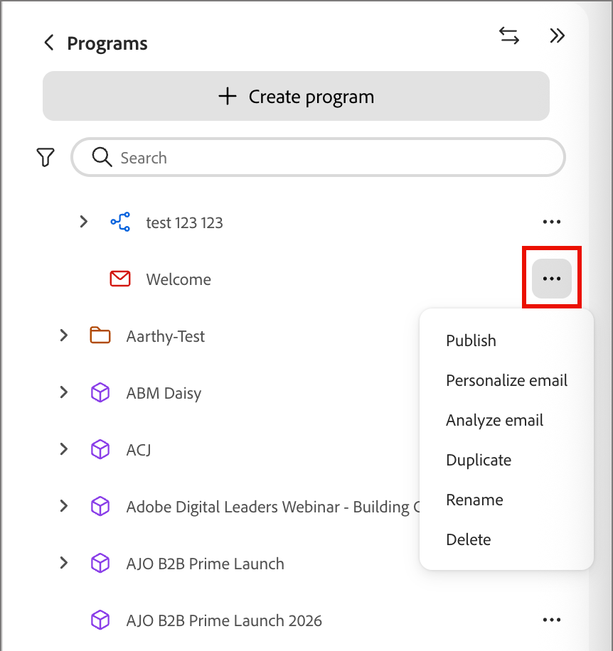
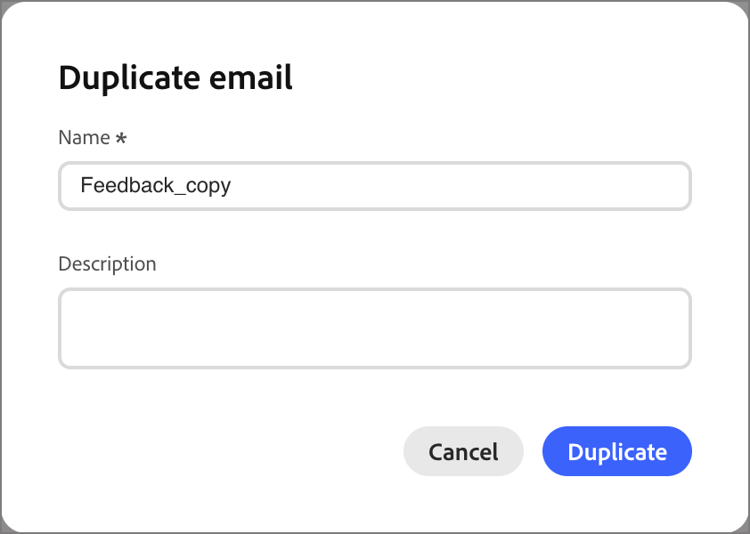

# 建立電子郵件並將其新增至歷程

[!DNL Adobe Marketo Optimizer]為B2B行銷人員帶來現代的企業級電子郵件製作和傳遞體驗，讓您可從方案和歷程建立、發佈和傳送電子郵件。

電子郵件是獨立資產，因此您不需要歷程即可建立電子郵件。 [在程式或其中一個資料夾中建立電子郵件](#create-email-from-programs)，[發佈它](#publish-email) （當它準備就緒時），然後[從該程式的任何歷程傳送它](#add-email-from-journey)。

## 電子郵件生命週期 {#lifecycle}

電子郵件一律為下列其中一種狀態：

| 狀態 | 說明 |
| ----- | ----------- |
| **草稿** | 每封新電子郵件都會以草稿開始，草稿會在程式樹狀結構中以紅色信封圖示顯示。 您可以編輯其屬性、動作和內容，也可以個人化、分析、重新命名或刪除它。 |
| **已發佈** | 已發佈的電子郵件已鎖定且準備傳送，並顯示一個綠色信封圖示。 它無法編輯或取消發佈，當您在歷程中挑選電子郵件時，它會列出。 |
| **在歷程中** | 當您在&#x200B;_傳送電子郵件_&#x200B;動作中選取已發佈的電子郵件時，會建立屬於歷程的已發佈復本。 該副本是唯讀的，如果後來複製和修訂原始副本，則不會變更。 |

當您發佈電子郵件時，它會從草稿移至已發佈。 為&#x200B;_傳送電子郵件_&#x200B;動作節點選取時，歷程中會有復本。 若要變更已發佈的電子郵件，請[複製它](#duplicate-email)。 重複專案會建立為具有相同內容和設定的草稿。

{width="800" zoomable="yes"}

電子郵件狀態決定動作可用性：

| 動作 | 草稿 | 發佈日期 | 在歷程中 |
| ------ | ----- | --------- | ------------ |
| 編輯屬性、動作和內容 | 是 | 無 | 無 |
| 個人化電子郵件 | 是 | 無 | 無 |
| 分析電子郵件 | 是 | 無 | 無 |
| 發佈 | 是，封鎖警示解決之後 | 已發佈 | 已自動發佈 |
| 重複 | 是 | 是 | 無 |
| 重新命名 | 是 | 無 | 否。 當您選取復本時，請為其命名。 |
| 刪除 | 是 | 無 | 否。 請改為刪除&#x200B;_傳送電子郵件_&#x200B;節點。 |
| 在歷程中選取 | 無 | 是 | 不適用 |

## 先決條件 {#before-you-begin}

請確定您的使用者角色包含您執行之工作的下列[產品許可權](../start/permissions-reference.md)：

* **[!UICONTROL 檢視B2B程式]**&#x200B;和&#x200B;**[!UICONTROL 檢視B2B資料夾]** — 檢視電子郵件所在的程式和資料夾。
* **[!UICONTROL 檢視B2B電子郵件]** — 檢視電子郵件。
* **[!UICONTROL 管理B2B電子郵件]** — 建立、編輯、複製、重新命名、刪除和發佈電子郵件。
* **[!UICONTROL 管理B2B個人歷程]** — 在個人歷程中新增或取代電子郵件動作。 若要以唯讀方式存取歷程，請使用&#x200B;**[!UICONTROL 檢視B2B個人歷程]**。
* **[!UICONTROL 管理B2B對話體驗]** — 存取[!DNL Coworker]以個人化或分析電子郵件。 [!DNL Coworker]中的動作也需要對應的電子郵件許可權。

只有當您執行下列相關設定或傳送工作時，才需要其他許可權：

* **[!UICONTROL 管理B2B程式]** — 如果程式尚不存在，請建立程式。
* **[!UICONTROL 管理B2B通道設定]**&#x200B;和&#x200B;**[!UICONTROL 檢視B2B電子郵件設定]** — 建立電子郵件通道設定。 系統管理員還需要&#x200B;**[!UICONTROL 管理B2B電子郵件設定]**&#x200B;才能設定電子郵件傳遞設定。
* **[!UICONTROL 發佈B2B個人歷程]** — 發佈傳送電子郵件的歷程。

建立電子郵件之前，請確認下列事項：

* 電子郵件位於方案或其資料夾中。 在建立電子郵件之前定義程式。 歷程只能從自己的方案傳送電子郵件。
* 若要選取電子郵件通道設定，請使用電子郵件&#x200B;**[!UICONTROL 動作]**&#x200B;索引標籤。 管理員管理[電子郵件通道設定](../admin/email-channel-configuration.md)。
* 您可以在計畫內建立所需數量的電子郵件。

>[!NOTE]
>
>如果您是第一次傳送電子郵件，請確定已設定[電子郵件傳遞能力](../start/email-deliverability.md)和所需的[電子郵件通道](../admin/email-channel-configuration.md)。

<!-- 
* **Email channel configurations** - Manage the sender identity, reply behavior, marketing vs. transactional message types, and tracking.
* **Email deliverability controls** - Set up your email deliverability channel, including subdomain delegation (Fully Delegated and CNAME methods), DMARC, SPF/DKIM auto-configuration, and shared IP pool support.
* **Send Email action** - From a journey, add a _Send email_ action node, including personalization using profile attributes (Handlebars syntax).
* **Visual drag-and-drop email design tools** -  Design your email content with structures, content components, themes, dark-mode support, and reusable visual fragments.
* **Marketo Design Studio assets** — Choose images and assets from a one-time copy of your Marketo Engage asset library directly inside the email canvas.
* **Reusable templates and fragments** — Save common headers, footers, CTAs, and full email layouts and reuse them across journeys.
* **Role-Based Access Control (RBAC)** — Apply granular permissions for creating, editing, approving, and sending email. 
-->

>[!BEGINSHADEBOX]

## 目前限制 {#limitations}

* **測試設定檔、模擬內容和傳送校樣**&#x200B;在目前版本中無法使用。 Litmus呈現和以SpamAssassin為基礎的垃圾郵件報告已規劃在未來版本。
* **目前版本中無法使用帳戶層級的個人化與自訂物件資料**。 使用設定檔屬性。
* 現有[!DNL Marketo Engage]範本的&#x200B;**Velocity-to-Handlebars自動移轉**&#x200B;可依要求提供。
* **電子郵件評論和共同作業** （內嵌評論、@mentions務、要求稽核工作流程）已規劃在未來發行。
* **AEM Assets、AEM內容片段和Adobe Express**&#x200B;整合已規劃於未來版本中。

>[!ENDSHADEBOX]

## 重要概念 {#key-concepts}

在為人員歷程建立電子郵件並編寫電子郵件內容之前，請先檢閱以下概念：

| 概念 | 在[!DNL Adobe Marketo Optimizer] |
| ------- | ---------------------- |
| **_[電子郵件設計空間](../content/email-authoring.md#email-design-tools)_** | 用於撰寫電子郵件內容的視覺畫布和設計工具。 其中包含拖放式版面配置元件、範本、片段、主題和個人化編輯器。 |
| **_[範本](../content/templates.md)_** | 可重複使用的電子郵件配置，可用於建立新電子郵件。 範本可以是Adobe提供的內建範例範本，也可以是您的團隊建立的自訂範本。 |
| **_[視覺片段](../content/fragments.md)_** | 可重複使用的內容區塊（例如頁首、頁尾、CTA、法律免責宣告），可插入多封電子郵件中。 更新片段會將變更傳播到使用它的每封電子郵件。 |
| **_[佈景主題](../content/email-authoring.md#design-from-scratch)_** | 可在電子郵件中套用的可重複使用樣式預設集（顏色、印刷樣式、間距、按鈕樣式）。 |
| **_[Personalization Token](../content/personalization-expressions.md)_** | Handlebars運算式（例如`{{profile.firstName}}`）在傳送時使用每個收件者的設定檔資料解析。 |
| **_[獨立電子郵件](#lifecycle)_** | 獨立於任何歷程存在的電子郵件資產。 它是在一個方案或其中一個資料夾中建立的，並且從草稿移至已發佈。 |
| **_[電子郵件型別](#email-types)_** | 您建立電子郵件時所選擇的分類： **[!UICONTROL 行銷]**&#x200B;或&#x200B;**[!UICONTROL 異動]**。 它會告訴[!DNL Marketo Optimizer]如何以同意為目的處理郵件。 |
| **_[傳送電子郵件動作](./action-nodes.md#add-an-action-node)_** | 歷程動作節點，使用通道設定和電子郵件內容來傳遞電子郵件。 |

## 電子郵件型別 {#email-types}

建立電子郵件時，您可以選擇其型別。 此型別會告訴[!DNL Marketo Optimizer]如何處理同意訊息，因此請選擇符合您傳送訊息原因的訊息。

| 類型 | 用於 |
| ---- | ------- |
| **[!UICONTROL 行銷]** | 促銷訊息，例如，產品上市公告、電子報或活動邀請。 |
| **[!UICONTROL 異動]** | 由于某人的行為所預期的營運訊息，例如訂單、註冊或出貨確認。 |

型別在&#x200B;**[!UICONTROL 屬性]**&#x200B;標籤上顯示為電子郵件&#x200B;**[!UICONTROL 類別]**。

## 在程式樹狀結構中建立電子郵件 {#create-email-from-programs}

在程式或資料夾中建立電子郵件，以獨立於任何歷程進行建置。

1. 在左側導覽列中，展開&#x200B;**[!UICONTROL 行銷管理]**&#x200B;並選取&#x200B;**[!UICONTROL 方案]**。

1. 在程式樹狀結構中，按一下&#x200B;_更多_&#x200B;圖示(**...**) 在您要建立電子郵件的程式或資料夾旁邊，然後選取&#x200B;**[!UICONTROL 建立電子郵件]**。

   {width="400"}

1. 在&#x200B;_[!UICONTROL 建立電子郵件]_&#x200B;對話方塊中，完成下列欄位：

   * **[!UICONTROL Parent]** - （必要）儲存電子郵件的程式或資料夾。 它會設定為您開始使用的程式，您可以將其變更為其他程式或程式的其中一個資料夾。

   * **[!UICONTROL 電子郵件型別]** — 選取&#x200B;**[!UICONTROL 行銷]**&#x200B;或&#x200B;**[!UICONTROL 異動]** （請參閱[電子郵件型別](#email-types)）。

   * **[!UICONTROL 名稱]** - （必要）在程式樹狀結構中輸入識別電子郵件的名稱。

   * **[!UICONTROL 說明]** - （選擇性）輸入電子郵件及其用途的相關備註。

   {width="400"}

1. 按一下&#x200B;**[!UICONTROL 建立]**。

電子郵件會在其自己的標籤中開啟，並在方案樹中的方案下顯示為草稿。 當電子郵件開啟時，任何[!DNL Coworker]提示的範圍皆為該電子郵件。

接著，[設定電子郵件](#define-email-properties)、[解決任何警示](#alerts)和[發佈它](#publish-email)。

### 定義電子郵件屬性和動作 {#define-email-properties}

草稿電子郵件有三個標籤： **[!UICONTROL 屬性]**、**[!UICONTROL 動作]**&#x200B;和&#x200B;**[!UICONTROL 內容]**。 依序處理變更，然後儲存變更。 當您在程式樹中建立電子郵件時，電子郵件頁面會開啟。 若要稍後開啟草稿，請在程式樹狀結構中選取電子郵件。

#### 完成「屬性」和「動作」標籤 {#properties-actions-tabs}

1. （選擇性）在&#x200B;**[!UICONTROL 屬性]**&#x200B;索引標籤中，輸入&#x200B;**[!UICONTROL 描述]**&#x200B;以及您要擷取給電子郵件的任何其他描述性資訊。

   {width="800" zoomable="yes"}

1. 選取&#x200B;**[!UICONTROL 動作]**&#x200B;標籤，並完成電子郵件的功能設定：

   * **[!UICONTROL 電子郵件]** — 選取或建立要使用的&#x200B;**[!UICONTROL 電子郵件通道設定]**。

     這是一組可重複使用的電子郵件傳送設定，可定義寄件者身分、回覆位址、子網域、IP集區、電子郵件型別（行銷或異動）以及追蹤。 按一下&#x200B;_檢視_&#x200B;圖示以檢閱所選組態的設定。

     管理員在[電子郵件通道設定](../admin/email-channel-configuration.md)中建立設定。

   * **[!UICONTROL 商業規則]** - （選擇性）選取規則集，將上限或無訊息時數規則套用至您的電子郵件動作。

     如需有關商業規則以及如何定義及啟用通道通訊規則集的詳細資訊，請參閱&#x200B;[_商業規則_](../admin/business-rules.md)。

   * **[!UICONTROL 動作追蹤]** — 選取您要追蹤電子郵件之動作的核取方塊。

   {width="600" zoomable="yes"}

#### 新增主旨行和內容 {#content-tab}

1. 按一下「**[!UICONTROL 編輯內容]**」，或選取「**[!UICONTROL 內容]**」標籤。

   {width="500" zoomable="yes"}

1. 輸入要顯示在電子郵件主旨欄位中的&#x200B;**[!UICONTROL 主旨列]**&#x200B;文字。

   主旨列為必填。

   按一下「_個人化_」圖示（「」）以在欄位中使用個人化權杖。

1. （選用）選取&#x200B;**[!UICONTROL 最佳化HTML大小]**&#x200B;核取方塊，在發佈程式期間縮小電子郵件HTML的大小。

   這有助於防止使用者端（例如Gmail）中的電子郵件剪輯。 Gmail會截斷超過100 KB的郵件。 如需詳細資訊，請參閱&#x200B;[_最佳化電子郵件HTML大小_](#optimize-html-size)。

1. 按一下&#x200B;**[!UICONTROL 編輯電子郵件內文]**&#x200B;以存取視覺化設計工具並開始[建立您的內容](../content/email-authoring.md)。

   或者，您可以按一下&#x200B;**[!UICONTROL 代碼編輯器]**，以純HTML編碼您自己的內容。 如果您有現有的HTML可重複使用您的電子郵件設計，您可以將其複製並貼到編輯器中。

### 檢查警報 {#alerts}

電子郵件標題中的&#x200B;**[!UICONTROL 警示]**&#x200B;按鈕顯示[!DNL Adobe Marketo Optimizer]已發現的問題數。 按一下以顯示清單。

{width="450"}

警報有兩種型別：

* **封鎖問題** — 雖然這些問題仍會存在，**[!UICONTROL 無法發佈]**，且電子郵件的&#x200B;_更多_&#x200B;功能表顯示&#x200B;**[!UICONTROL 解決電子郵件警示以發佈]**。 請在發佈電子郵件之前解決所有封鎖問題。

  例如：

  * 寄件者名稱是空的
  * 缺少主旨列
  * 電子郵件內容是空的

* **警告** — 這些指出值得檢閱的內容，但不會阻止您發佈。 如果剩餘的警報是警告，電子郵件可以顯示警報，但仍會發佈。

  例如：

  * 電子郵件內文中沒有選擇退出連結
  * HTML的文字版本為空白
  * 偵測到空連結
  * 電子郵件超過100 K

## 管理方案樹狀結構中的電子郵件 {#manage-emails}

電子郵件會以信封圖示顯示在方案樹狀結構中。 紅色包絡標籤拔模。 綠色信封標籤已發佈的電子郵件。 按一下&#x200B;_更多_&#x200B;圖示(**...**) 在電子郵件旁進行管理。

在程式樹狀結構中的{width="400"}

草稿電子郵件的功能表包含&#x200B;**[!UICONTROL 發佈]**、**[!UICONTROL 個人化電子郵件]**、**[!UICONTROL 分析電子郵件]**、**[!UICONTROL 重複]**、**[!UICONTROL 重新命名]**&#x200B;以及&#x200B;**[!UICONTROL 刪除]**。

對於已發佈的電子郵件，**[!UICONTROL 複製]**&#x200B;是唯一的選項。

### 個人化及分析電子郵件 {#personalize-analyze}

雖然電子郵件是草稿，但其&#x200B;_更多_&#x200B;功能表包含兩個內容工具。 請在發佈前先執行這些動作，因為已發佈的電子郵件無法變更。

* **[!UICONTROL 個人化電子郵件]** — 載入電子郵件後開啟[!DNL Coworker]。 若要新增個人化內容至電子郵件，請說明目標群組。 如需詳細資訊，請參閱&#x200B;[_個人化電子郵件內容_](../agents/personalize-content.md)。

  {width="700" zoomable="yes"}

* **[!UICONTROL 分析電子郵件]** — 檢閱您已建立的內容。 請參閱[分析現有的電子郵件](../agents/personalize-content.md#analyze-existing-email)。

### 發佈電子郵件 {#publish-email}

準備好傳送電子郵件時發佈電子郵件。 當您[在歷程中選取電子郵件](#add-email-from-journey)時，只會列出已發佈的電子郵件。

1. 確定電子郵件沒有封鎖[警示](#alerts)。

1. 在程式樹狀結構中，按一下&#x200B;_更多_&#x200B;圖示(**...**) 在電子郵件旁邊，並選取&#x200B;**[!UICONTROL 發佈]**。

1. 在&#x200B;_[!UICONTROL 發佈電子郵件]_&#x200B;確認對話方塊中，按一下&#x200B;**[!UICONTROL 發佈]**。

   {width="400"}

電子郵件圖示會變成綠色。 如果您選取電子郵件，它會以唯讀檢視開啟，並摘要其內容、屬性和動作。

{width="700" zoomable="yes"}

>[!IMPORTANT]
>
>發佈是永久性的。 已發佈的電子郵件無法編輯、重新命名、刪除或傳回草稿。 若要進行變更，[複製電子郵件](#duplicate-email)。

### 複製電子郵件 {#duplicate-email}

若要變更已發佈的電子郵件，請複製該電子郵件。 若要嘗試變數而不變更原始專案，您也可以複製草稿。

1. 在程式樹狀結構中，按一下&#x200B;_更多_&#x200B;圖示(**...**) 在電子郵件旁邊，並選取&#x200B;**[!UICONTROL 複製]**。

1. 在&#x200B;_[!UICONTROL 重複的電子郵件]_&#x200B;對話方塊中，視需要變更&#x200B;**[!UICONTROL 名稱]**。

   預設為原始名稱，後面接著`_copy`。 選擇性地新增&#x200B;**[!UICONTROL 描述]**。

   {width="400"}

1. 按一下「**[!UICONTROL 重複]**」。

重複專案會建立為具有相同內容和設定的草稿。 進行變更，然後發佈。

## 將電子郵件新增至歷程 {#add-email-from-journey}

若要傳送電子郵件，請將其新增至相同計畫中的歷程。 當您選取電子郵件時，[!DNL Marketo Optimizer]會為該歷程製作一份副本，並自動發佈副本。 電子郵件來自程式樹狀結構，因此[請先建立並發佈電子郵件](#create-email-from-programs)。

您可在多個歷程中使用相同的電子郵件。 每次選取時，系統都會為該歷程建立個別副本，而您可以為每個副本指定唯一名稱。

### 選取「傳送電子郵件」動作的電子郵件 {#select-email-in-journey}

1. 開啟歷程，然後選取或新增&#x200B;[_採取動作_&#x200B;節點](action-nodes.md#add-an-action-node)。

1. 在&#x200B;_[!UICONTROL 選取動作]_&#x200B;中，選擇&#x200B;**[!UICONTROL 傳送電子郵件]**。

1. 在&#x200B;_[!UICONTROL 電子郵件來源]_&#x200B;底下，選擇下列其中一項：

   * **[!UICONTROL 從程式樹狀結構挑選電子郵件]** — 選擇此選項可使用歷程程式或其資料夾中已發佈的電子郵件。

   * **[!UICONTROL 使用AI個人化電子郵件]** — 選擇此選項可使用AI產生的電子郵件。 這些電子郵件已最佳化，因此AI輔助收件匣使用者端可在您的選件和行動號召中建立其摘要和答案。

   {width="600"}

   在您選擇電子郵件之前，節點會顯示空白的電子郵件名稱。

1. 按一下&#x200B;**[!UICONTROL 選取電子郵件]**。

   * **_程式樹狀結構電子郵件:_**&#x200B;在&#x200B;_[!UICONTROL 選取電子郵件]_&#x200B;對話方塊中，尋找並選取電子郵件。

     視需要使用&#x200B;**[!UICONTROL 搜尋電子郵件]**&#x200B;以篩選。 在清單中選取要預覽的電子郵件，並檢查主旨列。

     {width="600" zoomable="yes"}

     >[!NOTE]
     >
     >對話方塊僅列出來自Journey Program及其資料夾的已發佈電子郵件。 草稿要等您[發佈](#publish-email)後才會顯示。 如果電子郵件未出現，請檢查它是否已發佈（綠色圖示），以及它是否位於正確的程式中。

     在&#x200B;**[!UICONTROL Name]**&#x200B;中，輸入電子郵件在歷程中應具有的名稱。

     預設為原始名稱，後面接著`_copy`。 將其重新命名為歷程內容中適當的名稱。

   * **_AI個人化電子郵件:_**&#x200B;在&#x200B;_[!UICONTROL 選取AI產生的電子郵件]_&#x200B;對話方塊中，尋找並選取個人化電子郵件。

     從清單中選取個人化電子郵件。 此對話方塊會列出儲存在AI資料庫中的&#x200B;_AI個人化電子郵件_。 如需詳細資訊，請參閱依角色個人化電子郵件內容。

     {width="450" zoomable="yes"}

1. 按一下&#x200B;**[!UICONTROL 選取]**。

### 歷程電子郵件副本 {#journey-copy}

復本會新增至歷程、已發佈，並以橘色圖示列在方案樹中的歷程下方。 它具有自己的動作ID，而且是唯讀的。

{width="700" zoomable="yes"}

歷程會保留自己的副本。 當您選取電子郵件時，將會複製內容和設定。 如果您稍後複製並修訂原始版本，現有歷程會繼續傳送複製的版本。

針對選用的[傳送時間最佳化](email-send-time-optimization.md)，請在選取電子郵件之後設定歷程動作節點。

### 更新歷程中的電子郵件 {#update-email-in-journey}

由於歷程的復本是唯讀的，因此您可以加以取代，而非編輯。

1. [複製](#duplicate-email)已發佈的原始電子郵件、變更草稿，然後[發佈](#publish-email)。

1. 在歷程中，選取&#x200B;_傳送電子郵件_&#x200B;節點，並使用&#x200B;_執行動作_&#x200B;面板中的垃圾桶圖示將其刪除。

1. 新增新的&#x200B;_傳送電子郵件_&#x200B;動作，並選取更新的電子郵件。

## 最佳化電子郵件 HTML 大小 {#optimize-html-size}

>[!CONTEXTUALHELP]
>id="ajo-b2b-prime_email_minification"
>title="縮減 HTML 大小"
>abstract="啟用此選項可移除不必要的空白字元、縮排及非必要的註解，以便在發佈時壓縮電子郵件 HTML。 這有助於防止使用者端（例如Gmail）中的電子郵件剪輯。 Gmail會截斷超過100 KB的郵件。"

[!DNL Marketo Optimizer]可讓您移除不必要的空白字元、縮排及不必要的註解，在發佈程式期間壓縮電子郵件HTML版本。 保持HTML小型化可協助您：

* 避免&#x200B;**電子郵件剪輯** — 某些使用者端（例如Gmail）會截斷大於~100 KB的郵件，使收件者無法檢視完整內容。
* 改善收件者收件匣中的&#x200B;**電子郵件載入時間**。
* 改善&#x200B;**傳遞能力**&#x200B;並減少頻寬使用量。

此最佳化不會自動套用 — 您必須在&#x200B;_[!UICONTROL 內容]_&#x200B;索引標籤中啟用它。

<!--  -->

>[!IMPORTANT]
>
> HTML大小縮減僅適用於發佈時。

最佳化是電子郵件使用者端安全：

* 它會保留MSO/Outlook條件式註解。
* 這不會改變您的實際內容、影像或視訊。

>[!NOTE]
>
>電子郵件大小的縮減取決於電子郵件原始HTML結構。 如果內容已壓縮或電子郵件承載非常大，縮減量可能會很小，並且可能無法完全防止剪輯。

<!-- 
Proof and simulate workflows are not available in this release. See [Current limitations](#limitations).

### Test HTML size optimization {#optimize-html-proof}

If you have enabled the [HTML size optimization](#optimize-html-size) option, you can evaluate its impact before publishing when sending proofs. Follow the following steps.

1. In the email design space, click the _Issues_ icon on the top right. If the rendered email size exceeds 100 KB, a message is displayed to warn you that this may cause truncation in some email clients.

1. Click **[!UICONTROL Simulate content]**.

1. To test the optimized version, click the **[!UICONTROL Send proof]** button and select the **[!UICONTROL Optimize HTML size]** option. This will send a proof with the reduced HTML size to your test recipients.

    >[!NOTE]
    >
    >This setting is independent from the email editor — the proof reflects what you select in the proof, regardless of whether the option is enabled or disabled in the email itself.

1. Select the test recipients and click **[!UICONTROL Send proof]**.

1. Back in the **[!UICONTROL Simulate]** screen, click the **[!UICONTROL View Proof]** button.

1. Click the _Information_ icon next to the status of the proof.

   The optimization details are displayed in a pop-up window, including the original HTML size, the optimized HTML size, and the size reduction percentage.
    
    Use this information to validate the optimized output and confirm the email stays within the recommended 100 KB threshold before publishing.

-->
