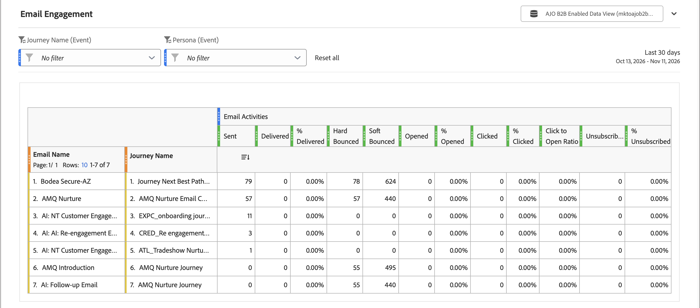
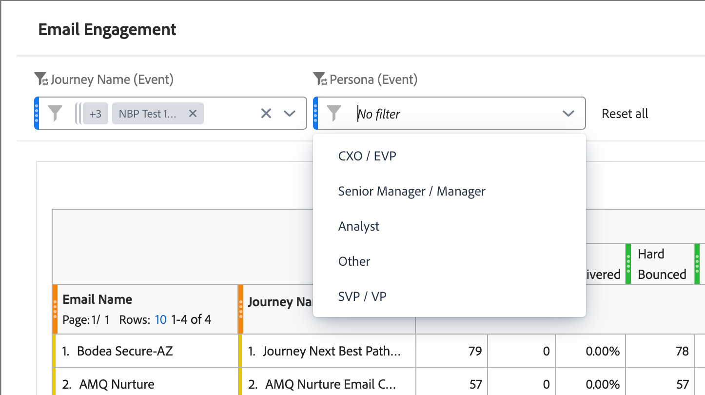

# 以電子郵件傳送參與報告

<!-- SPHR-32511: Filter by Program, Filter by Audience, and the program data point for the email performance table are not documented here pending delivery. -->

使用[!UICONTROL 電子郵件參與]報告來檢閱您執行個體的電子郵件傳遞能力及參與效能，其資料會依電子郵件和歷程加以劃分。

檢視報告(_T):_

1. 在左側導覽中，選取&#x200B;**[!UICONTROL 報表]**。
1. 按一下&#x200B;_清單_&#x200B;圖示（）並選取&#x200B;_[!UICONTROL 目錄]_&#x200B;面板中的&#x200B;**[!UICONTROL 電子郵件參與]**。

{width="700" zoomable="yes"}

使用報告頂端的&#x200B;**[!UICONTROL 歷程名稱（事件）]**&#x200B;和&#x200B;**[!UICONTROL 角色（事件）]**&#x200B;篩選器來縮小電子郵件資料。 開啟篩選器清單並選取要包含的值。 請參閱[篩選器](#filters)。

您可以[使用其他報表區段上可用的相同日期範圍選擇器來變更日期範圍](./reports-overview.md#change-the-date-range)。

選取報表頂端的&#x200B;**[!UICONTROL 共用]**&#x200B;以下載或排程所有報表資料的匯出。 請參閱報表概觀中的&#x200B;[_匯出報表_](./reports-overview.md#export-a-report)。

## 報告表格 {#report-table}

[!UICONTROL 電子郵件參與]報告為每封電子郵件顯示一列，列維度如下。

* **[!UICONTROL 電子郵件名稱]** — 電子郵件的名稱。
* **[!UICONTROL 歷程名稱]** — 傳送電子郵件的歷程名稱。

量度欄會分組到&#x200B;**[!UICONTROL 電子郵件活動]**&#x200B;下。

| 欄 | 說明 |
| --- | --- |
| [!UICONTROL 已傳送] | 已傳送的電子郵件數目。 |
| [!UICONTROL 已傳遞] | 傳遞的電子郵件數量。 |
| [!UICONTROL %已傳遞] | 已傳遞的已傳送電子郵件百分比。 |
| [!UICONTROL 硬退信] | 永久無法傳送的電子郵件數目。 |
| [!UICONTROL 軟退信] | 暫時無法傳送的電子郵件數目。 |
| [!UICONTROL 已開啟] | 收件者開啟電子郵件的次數。 |
| [!UICONTROL %已開啟] | 已開啟的傳遞電子郵件百分比。 |
| [!UICONTROL 已點按] | 收件者點按電子郵件中連結的次數。 |
| [!UICONTROL %已點按] | 收到點按的傳遞電子郵件百分比。 |
| [!UICONTROL 按一下以開啟比例] | 收到點按的已開啟電子郵件百分比。 |
| [!UICONTROL 已取消訂閱] | 取消訂閱電子郵件的收件者人數。 |
| [!UICONTROL %已取消訂閱] | 導致取消訂閱的傳遞電子郵件百分比。 |

## 篩選器 {#filters}

使用篩選器來依歷程或角色縮小報表。

* **[!UICONTROL 歷程名稱（事件）]** — 依傳送電子郵件的歷程篩選。 預設為[!UICONTROL 沒有篩選器]。
* **[!UICONTROL 角色（事件）]** — 依與電子郵件相關聯的[衍生角色](../audiences/personas.md#filter-by-derived-persona)篩選。 預設為[!UICONTROL 沒有篩選器]。

{width="500" zoomable="yes"}

選取&#x200B;**[!UICONTROL 全部重設]**&#x200B;以清除每個篩選器並返回預設檢視。