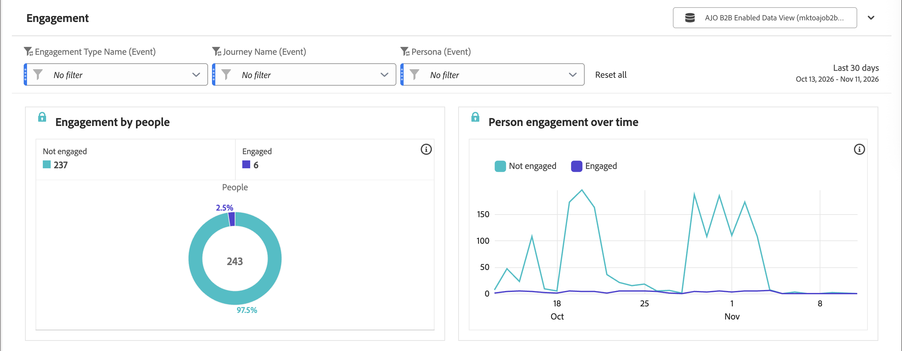
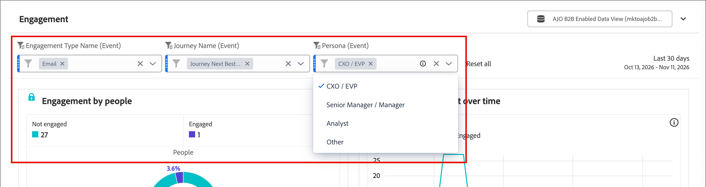

# 參與度報告

使用[!UICONTROL 參與度]報告來檢閱人們如何參與您的行銷方案，包括隨著時間推移的個人參與度和參與度趨勢。

檢視報告(_T):_

1. 在左側導覽中，選取&#x200B;**[!UICONTROL 報表]**。
1. 按一下&#x200B;_清單_&#x200B;圖示（）並選取&#x200B;_[!UICONTROL 目錄]_&#x200B;面板中的&#x200B;**[!UICONTROL 參與]**。

## 報告圖磚 {#report-tiles}

[!UICONTROL Engagement]報告包含兩個圖磚。

* **[!UICONTROL 人員的參與度]** — 顯示您執行個體中不同人員的參與度。
* **[!UICONTROL 一段時間內的人員參與]** — 顯示人員參與在一段時間內的變化。

{width="700" zoomable="yes"}

您可以[變更每個報表圖磚的日期範圍](./reports-overview.md#change-the-date-range)。

選取報表頂端的&#x200B;**[!UICONTROL 共用]**&#x200B;以下載或排程所有報表資料的匯出。 請參閱報表概觀中的&#x200B;[_匯出報表_](./reports-overview.md#export-a-report)。

## 篩選器 {#filters}

使用報告頂端的篩選器來縮小參與資料的範圍。 開啟篩選器清單並選取要包含的值。

* **[!UICONTROL 參與型別名稱（事件）]** — 依參與型別（例如電子郵件）篩選。 預設為[!UICONTROL 沒有篩選器]。
* **[!UICONTROL 歷程名稱（事件）]** — 依與參與相關聯的歷程篩選。 預設為[!UICONTROL 沒有篩選器]。
* **[!UICONTROL 角色（事件）]** — 依與參與關聯的[衍生角色](../audiences/personas.md#filter-by-derived-persona)篩選。 預設為[!UICONTROL 沒有篩選器]。

{width="500" zoomable="yes"}

選取&#x200B;**[!UICONTROL 全部重設]**&#x200B;以清除每個篩選器並返回預設檢視。
