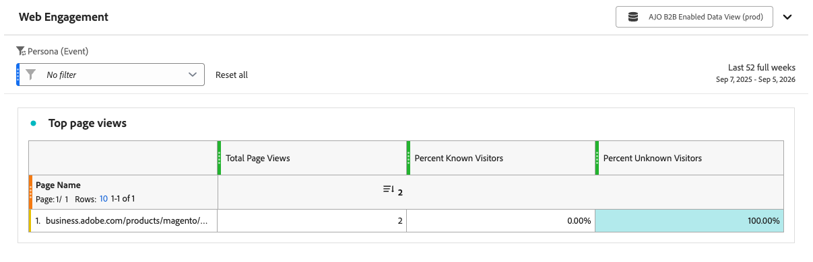
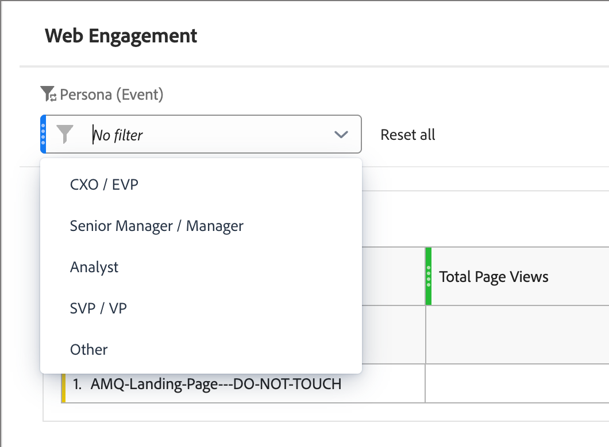

# Web參與報告

<!-- SPHR-39571: Audience, Company Name, Company Industry, and Region filters, plus the report title/subtitle rename, are planned under SPHR-32471 (not yet shipped) and should be documented separately once delivered  -->

使用[!UICONTROL Web Engagement]報告檢閱您執行個體中最受歡迎的互動式網路研討會的參與情形。

檢視報告(_T):_

1. 在左側導覽中，選取&#x200B;**[!UICONTROL 報表]**。
1. 按一下&#x200B;_清單_&#x200B;圖示（）並選取&#x200B;_[!UICONTROL 目錄]_&#x200B;面板中的&#x200B;**[!UICONTROL Web參與]**。

{width="700" zoomable="yes"}

您可以[變更報告的日期範圍](./reports-overview.md#change-the-date-range)。

選取報表頂端的&#x200B;**[!UICONTROL 共用]**&#x200B;以下載或排程所有報表資料的匯出。 請參閱報表概觀中的&#x200B;[_匯出報表_](./reports-overview.md#export-a-report)。

## 報告表格 {#report-table}

[!UICONTROL Web參與]報表會顯示您執行個體中最常檢視的10個頁面，其列維度如下。

* **[!UICONTROL 頁面名稱]** — 網頁的名稱。

| 欄 | 說明 |
| --- | --- |
| 總共[!UICONTROL 個頁面檢視] | 頁面的檢視總數。 |
| [!UICONTROL 百分比已知訪客] | 來自已知訪客的檢視百分比。 |
| [!UICONTROL 百分比未知的訪客] | 來自未知訪客的檢視百分比。 |

## 篩選器 {#filters}

使用報告頂端的&#x200B;**[!UICONTROL 角色（事件）]**&#x200B;篩選器來縮小頁面檢視資料。 開啟篩選器清單並選取要包含的值。

* **[!UICONTROL 角色（事件）]** — 依與頁面檢視相關聯的[衍生角色](../audiences/personas.md#filter-by-derived-persona)篩選。 預設為[!UICONTROL 沒有篩選器]。

{width="500" zoomable="yes"}

選取&#x200B;**[!UICONTROL 全部重設]**&#x200B;以清除篩選器並返回預設檢視。

>[!NOTE]
>
>針對對象、公司名稱、公司產業和區域的篩選器已規劃於未來版本。
