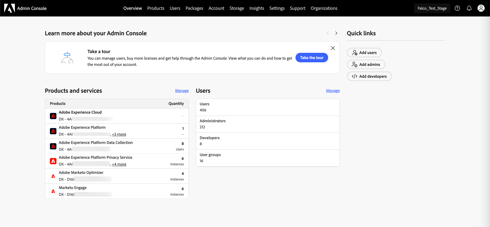
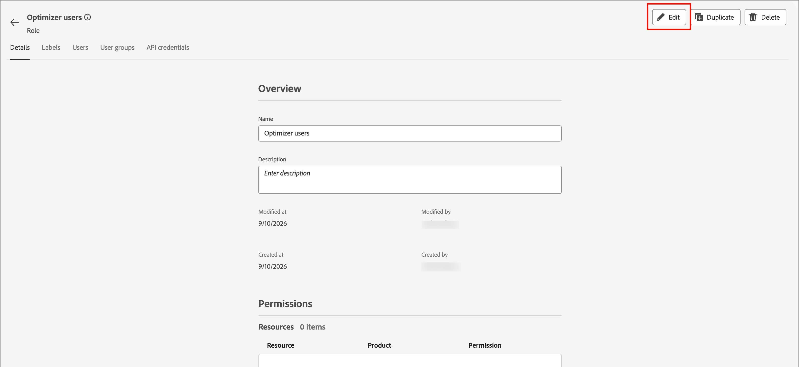
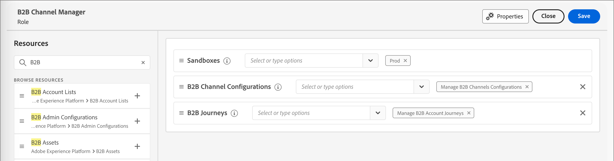
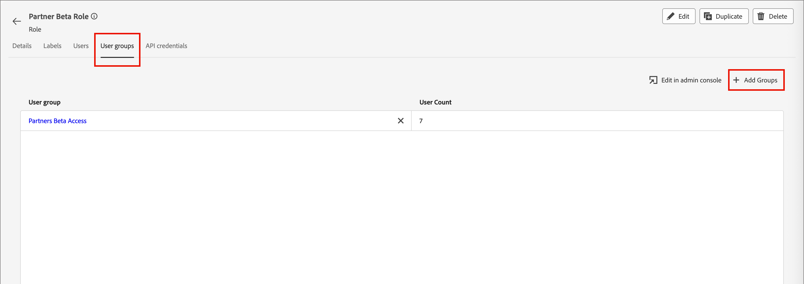
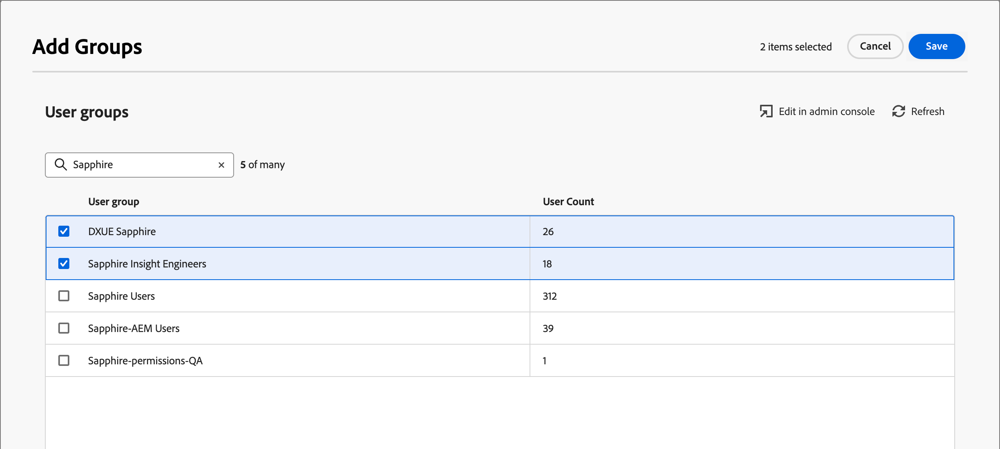

# 使用者存取和許可權

布建完成並繫結沙箱後，請完成下列步驟，為您的團隊和使用者提供[!DNL Marketo Optimizer]存取權。

1. [在Admin Console中建立 [!DNL Marketo Optimizer] 產品設定檔](#create-profile) （僅限一次性/初始設定）。
1. 在Admin Console中[新增使用者群組](#add-user-group)。
1. [將產品設定檔](#assign-profile)指派給Admin Console中的使用者群組。
1. [在Admin Console中將使用者新增至新群組](#add-users)。
1. [編輯內建角色](#edit-role-permissions)或[建立具有產品許可權的自訂角色](#create-a-custom-role)，並在Experience Platform中建立必要的[!DNL Marketo Optimizer]沙箱。
1. [新增使用者](#add-users-to-a-role)或[群組](#add-user-groups-to-a-role)至Adobe Experience Platform中的角色。

若要為管理員、所有存取許可權的使用者和唯讀使用者設定建議的使用者群組和角色，請參閱[建議的使用者型別](./permissions-reference.md#suggested-user-types)和[為建議的使用者型別建立使用者群組和角色](#create-suggested-roles)。

## 設定產品設定檔 {#config-profile}

作為管理員，您可以在[!DNL Adobe Admin Console]中完成這些工作，這是管理及管理Adobe產品授權和使用者的中心位置。 在Admin Console中，您可以在單一位置而非在各種個別解決方案中建立和管理使用者。 若要瞭解其功能的詳細資訊，請參閱[Admin Console概觀](https://helpx.adobe.com/business/enterprise/deploy-apps-updates.html)頁面。

### 存取Admin Console {#admin-console}

在使用Admin Console管理團隊中的使用者之前，您需要確保您可以存取Admin Console並擁有適當的許可權。

1. 作為系統管理員，您應該會在上線流程中收到來自Adobe的多封電子郵件。

   找到歡迎電子郵件，提供您被授予存取權的組織名稱相關資訊。

1. 按一下歡迎電子郵件中的&#x200B;**[!UICONTROL 開始使用]**&#x200B;連結，以瀏覽至Admin Console。

   如果找不到電子郵件，請直接在[https://adminconsole.adobe.com](https://adminconsole.adobe.com)開啟瀏覽器並存取Admin Console。

1. 使用您的Adobe ID登入。

   登入成功後，您會看到Adobe Admin Console的&#x200B;_概觀_&#x200B;頁面。

1. 如果您可以存取多個組織，請確保您已登入正確的組織。

   若要變更您的組織，請按一下右上角的組織名稱，然後選擇您需要存取的組織。

1. 從&#x200B;_[!UICONTROL 使用者]_&#x200B;卡中選擇&#x200B;**[!UICONTROL 管理員]**&#x200B;以驗證您是系統管理員。

   {width="800" zoomable="yes"}

1. 透過輸入您的Adobe ID電子郵件、使用者名稱、名字或姓氏進行搜尋。

   * 如果您的存取權設定正確，搜尋會傳回您的記錄。

   * 如果&#x200B;**[!UICONTROL 管理員角色]**&#x200B;欄中的值顯示`System`，您就知道您（或顯示的使用者）是系統管理員。

### 建立[!DNL Marketo Optimizer]產品設定檔 {#create-profile}

在授與使用者Adobe解決方案的存取權時，您不一定要授與他們完整的存取權。 產品設定檔使每個解決方案都可以擁有自己的一組使用者許可權。 使用Admin Console指派產品設定檔。

如需有關使用產品設定檔取得使用者許可權的詳細資訊，請參閱Admin Console檔案中的&#x200B;[_管理企業使用者的產品設定檔_](https://helpx.adobe.com/business/enterprise/products-entitlements/manage-product-profiles/product-profiles.html){target="_blank"}。

{width="30"} 系統管理員或[!DNL Experience Platform]產品管理員可以從[https://adminconsole.adobe.com](https://adminconsole.adobe.com)執行下列步驟。

1. 選取「**[!UICONTROL 產品]**」標籤。

1. 開啟您想要新增設定檔的[!DNL Marketo Optimizer]執行個體，然後按一下&#x200B;**[!UICONTROL 新增設定檔]**。

1. 輸入產品設定檔名稱，例如&#x200B;_存取_。

1. 按一下[下一步]****，然後按一下[儲存]****。

### 新增使用者群組 {#add-user-group}

使用者群組是獲授一組共用許可權的使用者集合。 您可以在使用者群組中新增或移除使用者。 當群組內的使用者變更時，群組權限會維持不變。

如需有關如何使用使用者群組來管理許可權的詳細資訊，請參閱Admin Console檔案中的[管理使用者群組](https://helpx.adobe.com/business/enterprise/users/users-and-groups/user-groups.html){target="_blank"}。

{width="30"} 系統管理員可以從[https://adminconsole.adobe.com](https://adminconsole.adobe.com)執行下列步驟。

1. 選取&#x200B;**[!UICONTROL 使用者]**&#x200B;索引標籤。

1. 在左側導覽中選擇&#x200B;**[!UICONTROL 使用者群組]**。

1. 按一下右上角的&#x200B;**[!UICONTROL 新增使用者群組]**。

1. 輸入使用者群組的名稱，例如&#x200B;_最佳化工具使用者_，然後按一下&#x200B;**[!UICONTROL 儲存]**。

   {width="600" zoomable="yes"}

### 指派產品設定檔 {#assign-profile}

{width="30"} 產品管理員可以從[https://adminconsole.adobe.com](https://adminconsole.adobe.com)執行下列步驟。

1. 按一下您建立的使用者群組。

1. 選取&#x200B;**[!UICONTROL 指派的產品設定檔]**&#x200B;索引標籤，然後按一下&#x200B;**[!UICONTROL 指派設定檔]**。

1. 按一下&#x200B;**+**&#x200B;並新增下列產品的每個執行個體：

   * [!UICONTROL Adobe Marketo Optimizer — 存取]
   * [!UICONTROL Adobe Experience Platform - AEP-Default-All-Users]
   * [!UICONTROL Adobe Experience Platform Data Collection — 預設資料收集所有存取權]
   * [!UICONTROL Adobe Experience Platform — 預設的生產所有存取權]

   {width="600" zoomable="yes"}

1. 按一下&#x200B;**[!UICONTROL 儲存]**。

### 將使用者新增至新群組 {#add-users}

如需使用者管理的相關資訊，請參閱Admin Console檔案中的&#x200B;[_Adobe Admin Console使用者_](https://helpx.adobe.com/business/enterprise/users/understand-user-management/user-management-overview.html){target="_blank"}。

{width="30"} 系統管理員或產品管理員可以從[https://adminconsole.adobe.com](https://adminconsole.adobe.com)執行下列步驟。 產品管理員只能新增其組織中已存在的使用者。

1. 如果使用者不是您組織的成員，請新增每個使用者：

   * 在&#x200B;_[!UICONTROL 快速連結]_&#x200B;下，按一下&#x200B;**[!UICONTROL 新增使用者]**。

   * 輸入使用者的電子郵件地址，然後按一下&#x200B;**[!UICONTROL 新增為新的使用者]**。

     {width="600" zoomable="yes"}

   * 輸入名字和姓氏，然後按一下[儲存]。****

1. 將每位使用者新增至群組：

   * 按一下使用者名稱。

   * 在使用者詳細資訊頁面中，捲動至&#x200B;**[!UICONTROL 使用者群組]**。

   * 按一下左側的&#x200B;_更多_ ( **...** )圖示，然後選擇&#x200B;**[!UICONTROL 編輯使用者群組]**。

   * 按一下&#x200B;**[!UICONTROL 使用者群組]**&#x200B;下方的&#x200B;_新增_ ( **+** )圖示。

     {width="600" zoomable="yes"}

   * 選取您先前建立的使用者群組，然後按一下&#x200B;**[!UICONTROL 套用]**。

   * 按一下&#x200B;**[!UICONTROL 儲存]**&#x200B;以取得使用者變更。

## 指派產品許可權 {#assign-product-permissions}

許可權是統一許可權，可讓您定義指派給產品設定檔的授權。 每個許可權都會分組在功能下，例如人員歷程或內容，代表[!DNL Marketo Optimizer]中的功能。

Adobe Experience Platform的&#x200B;_許可權_&#x200B;區域是管理員可以定義使用者角色和存取原則，以管理產品應用程式內功能和物件的存取許可權。 在此應用程式中，您可以建立和管理角色，並為這些角色指派所需的資源許可權。 許可權也可讓您管理與特定角色相關聯的沙箱和使用者。

如需Experience Platform中角色許可權的詳細資訊，請參閱Experience Platform檔案中的[管理角色](https://experienceleague.adobe.com/en/docs/experience-platform/access-control/abac/permissions-ui/permissions){target="_blank"}。

1. 移至[experience.adobe.com](https://experience.adobe.com/)。

1. 在&#x200B;_[!UICONTROL 快速存取]_&#x200B;面板中，選取&#x200B;**[!UICONTROL 許可權]**。

   >[!NOTE]
   >
   >如果您沒有看到&#x200B;_[!UICONTROL 許可權]_，您可能需要按一下「檢視全部&#x200B;**[!UICONTROL 」]**，然後從可用的應用程式中選取它。

   從Experience Platform的[快速存取]面板中選取的{width="700" zoomable="yes"}

### 許可權資源 {#permissions}

如需控制[!DNL Marketo Optimizer]功能存取權的完整許可權清單，包括說明和針對每種使用者型別建議的許可權，請參閱[產品許可權](./permissions-reference.md)頁面。

>[!IMPORTANT]
>
>[!DNL Marketo Optimizer]存取權需要您啟用使用下列命名慣例布建的特定沙箱： `Mktoaep` + [!DNL Marketo Engage]訂閱前置詞。 例如，如果連結的[!DNL Marketo Engage]訂閱首碼是&#x200B;_AcmeAssoc_，則存取[!DNL Marketo Optimizer]所需的沙箱是&#x200B;_MktoaepAcmeAssoc_。 將此沙箱新增至每個角色。

>[!NOTE]
>
>您必須是系統管理員才能在Experience Platform中看到&#x200B;_[!UICONTROL 許可權]_&#x200B;圖磚。

### 編輯角色許可權 {#edit-role-permissions}

對於內建或自訂角色，您可以隨時決定新增或刪除許可權。 如果您修改預設或自訂角色，則會影響指派給該角色的每個使用者。

>[!IMPORTANT]
>
>[!DNL Marketo Optimizer]存取權需要您啟用使用下列命名慣例布建的特定沙箱： `Mktoaep` + [!DNL Marketo Engage]訂閱前置詞。 例如，如果連結的[!DNL Marketo Engage]訂閱首碼是&#x200B;_AcmeAssoc_，則存取[!DNL Marketo Optimizer]所需的沙箱是&#x200B;_MktoaepAcmeAssoc_。

>[!NOTE]
>
>有權存取Experience Platform許可權的產品管理員可以執行這些步驟。

若要變更角色&#x200B;:_的許可權(_T)

1. 在左側導覽中選取&#x200B;**[!UICONTROL 角色]**。

1. 按一下&#x200B;**_最佳化工具使用者_**&#x200B;角色名稱。

1. 在詳細資訊頁面中，按一下右上方的&#x200B;**[!UICONTROL 編輯]**。

   已選取編輯專案，在Experience Platform許可權中顯示{width="800" zoomable="yes"}

   在角色編輯器中，_[!UICONTROL 資源]_&#x200B;功能表會顯示套用至Experience Cloud - Platform支援之應用程式的資源清單。

1. 選取為[!DNL Marketo Optimizer]存取權布建的沙箱(`Mktoaep<Marketo subscription prefix>`)。

   {width="500" zoomable="yes"}

1. 按一下每個功能資源的&#x200B;_新增_&#x200B;圖示(**+**)。

   {width="700" zoomable="yes"}

1. 為每個資源新增特定許可權，或選取&#x200B;**[!UICONTROL 全部新增]**。

1. 按一下&#x200B;**[!UICONTROL 儲存]**。

   <!-- {width="700" zoomable="yes"} -->

1. 按一下&#x200B;**[!UICONTROL 關閉]**&#x200B;以返回詳細資料頁面。

### 將使用者新增至角色 {#add-users-to-a-role}

{width="30"} 系統管理員或Experience Platform管理員可以執行以下步驟。

1. 開啟角色詳細資料，並選取&#x200B;**[!UICONTROL 使用者]**&#x200B;索引標籤。

   此標籤會顯示指派給角色的所有使用者清單。

1. 按一下&#x200B;**[!UICONTROL 新增使用者]**。

   在Experience Platform角色詳細資訊頁面中，選取[新增使用者]的[使用者]索引標籤。](./assets/aep-permissions-role-prime-add-users.png){width="800" zoomable="yes"}![

1. 在&#x200B;_[!UICONTROL 新增使用者]_&#x200B;對話方塊中，找出並選取您要新增至角色的使用者。

   * 您可以使用搜尋工具來篩選使用者清單。

   * 選取每個使用者的核取方塊。

   {width="600" zoomable="yes"}

1. 當您選取要新增的所有使用者時，請按一下&#x200B;**[!UICONTROL 儲存]**。

### 將使用者群組新增至角色 {#add-user-groups-to-a-role}

如需使用者管理的相關資訊，請參閱Admin Console檔案中的&#x200B;[_Adobe Admin Console使用者_](https://helpx.adobe.com/business/enterprise/users/understand-user-management/user-management-overview.html){target="_blank"}。

{width="30"} 系統管理員或Experience Platform管理員可以執行以下步驟。

1. 開啟角色詳細資料，並選取&#x200B;**[!UICONTROL 使用者群組]**&#x200B;索引標籤。

   此標籤會顯示指派給角色的所有使用者群組清單。

1. 按一下&#x200B;**[!UICONTROL 新增群組]**。

   {width="800" zoomable="yes"}

1. 在&#x200B;_[!UICONTROL 新增群組]_&#x200B;對話方塊中，找出並選取您要新增至角色的群組。

   * 您可以使用搜尋工具來篩選使用者群組清單。

   * 選取每個使用者群組的核取方塊。

   {width="600" zoomable="yes"}

1. 當您選取要新增的所有群組時，請按一下&#x200B;**[!UICONTROL 儲存]**。

### 建立自訂角色 {#create-a-custom-role}

{width="30"} 系統管理員或Experience Platform管理員可以執行以下步驟。

1. 在左側導覽中選取&#x200B;**[!UICONTROL 角色]**，然後選取&#x200B;**[!UICONTROL 建立角色]**。

1. 在&#x200B;_[!UICONTROL 建立新角色]_&#x200B;對話方塊中，輸入角色的名稱，例如&#x200B;_B2B行銷人員_，以及說明（選擇性）。

1. 按一下「**[!UICONTROL 確認]**」。

1. 選取為[!DNL Marketo Optimizer]存取權布建的沙箱(`Mktoaep<Marketo subscription prefix>`)。

   {width="500" zoomable="yes"}

1. 新增產品許可權：

   若要決定您想要用於角色的產品功能，請參閱[產品許可權](./permissions-reference.md)清單。

   在左側的&#x200B;_[!UICONTROL 資源]_&#x200B;清單中，找到B2B專案，然後按一下&#x200B;_新增_ (**+**)圖示以新增您想要為角色啟用的每個屬性。

   您可以在搜尋工具中輸入&#x200B;_B2B_，以篩選套用至[!DNL Marketo Optimizer]的許多B2B相關產品許可權的清單。

   {width="700" zoomable="yes"}

1. 按一下右上角的&#x200B;**[!UICONTROL 儲存]**。

1. 前往角色詳細資料，並選取&#x200B;**[!UICONTROL 使用者群組]**&#x200B;標籤。

1. 按一下&#x200B;**[!UICONTROL 新增群組]**。

1. 選取您先前在Admin Console中建立的使用者群組旁的核取方塊。

1. 按一下&#x200B;**[!UICONTROL 儲存]**。

您的自訂角色已設定，而且指派群組中的使用者現在可以存取您選取的[!DNL Marketo Optimizer]權能。

### 建立建議使用者型別的使用者群組和角色 {#create-suggested-roles}

使用以下程式設定&#x200B;_管理員_、_所有存取使用者_&#x200B;和&#x200B;_唯讀存取使用者_ [建議的使用者型別](./permissions-reference.md#suggested-user-types)。 對於每個使用者型別，您都可以在Admin Console中建立使用者群組，並在Experience Platform中建立角色，然後將群組新增至角色。 每個使用者型別的建議許可權列在&#x200B;[_產品許可權_](./permissions-reference.md)&#x200B;中。

#### 建立管理員使用者群組和角色 {#create-admin-group}

{width="30"} 系統管理員可以執行下列步驟。

1. 在Admin Console中，[新增名為&#x200B;_Marketo Optimizer管理員群組_&#x200B;的使用者群組](#add-user-group)，並[指派產品設定檔](#assign-profile)給該群組。

1. 將設定和管理[!DNL Marketo Optimizer]的使用者新增至群組。

1. 讓使用者成為產品管理員，以便他們可以管理使用者和群組。

1. 在[!UICONTROL Experience Platform] _[!UICONTROL 許可權]_&#x200B;中，選取&#x200B;**[!UICONTROL 角色]** > **[!UICONTROL 建立角色]**

1. 輸入名稱，例如&#x200B;_Marketo Optimizer系統管理員_，然後按一下&#x200B;**[!UICONTROL 確認]**。

1. 選取為[!DNL Marketo Optimizer]存取權布建的沙箱(`Mktoaep<Marketo subscription prefix>`)。

   >[!IMPORTANT]
   >
   >此步驟對於正確存取至關重要。

1. 針對下列每個類別，按一下&#x200B;_新增_ (**+**)圖示並選取&#x200B;**[!UICONTROL 全部新增]**：

   * _[!UICONTROL B2B管理組態]_
   * _[!UICONTROL B2B Assets]_
   * _[!UICONTROL B2B通道設定]_
   * _[!UICONTROL B2B對話體驗]_
   * _[!UICONTROL B2B目的地]_
   * _[!UICONTROL B2B資料夾權杖]_
   * _[!UICONTROL B2B資料夾]_
   * _[!UICONTROL B2B意圖組態]_
   * _[!UICONTROL B2B歷程]_
   * _[!UICONTROL B2B Labs]_
   * _[!UICONTROL B2B組織規則]_
   * _[!UICONTROL B2B人員清單]_
   * _[!UICONTROL B2B程式Token]_
   * _[!UICONTROL B2B程式型別]_
   * _[!UICONTROL B2B程式]_
   * _[!UICONTROL B2B報告]_
   * _[!UICONTROL 儀表板]_
   * _[!UICONTROL 目標]_
   * _[!UICONTROL 資料治理]_
   * _[!UICONTROL 資料擷取]_
   * _[!UICONTROL 設定檔管理]_

   >[!TIP]
   >
   >僅針對管理員角色使用&#x200B;**[!UICONTROL 全部新增]**。 發行新功能時，為其準備的許可權會自動套用至管理員角色，因此您不需要編輯角色。 對於其他使用者型別，在&#x200B;[_產品許可權_](./permissions-reference.md)&#x200B;中僅選取針對該型別建議的許可權。

1. 按一下&#x200B;**[!UICONTROL 儲存]**。

1. 在角色詳細資料中，選取&#x200B;**[!UICONTROL 使用者群組]**&#x200B;索引標籤，按一下&#x200B;**[!UICONTROL 新增群組]**，選取&#x200B;_Marketo Optimizer管理員群組_，然後按一下&#x200B;**[!UICONTROL 儲存]**。

#### 建立完全存取使用者群組和角色 {#create-all-access-group}

{width="30"} 系統管理員可以執行下列步驟。

1. 在Admin Console中，[新增名為&#x200B;_Marketo Optimizer使用者群組_&#x200B;的使用者群組](#add-user-group)、[將產品設定檔](#assign-profile)指派給該群組，以及[新增使用者](#add-users)至該群組。

1. 在Experience Platform許可權中，[建立名為&#x200B;_Marketo Optimizer所有存取使用者_&#x200B;的自訂角色](#create-a-custom-role)。

1. 選取為[!DNL Marketo Optimizer]存取權布建的沙箱(`Mktoaep<Marketo subscription prefix>`)。

1. 針對[產品許可權](./permissions-reference.md)中的每個類別，按一下&#x200B;_新增_ (**+**)圖示，然後只選取建議所有存取使用者使用的許可權。

   所有Access使用者都可以每天在每個功能中工作，但他們不會獲得管理員、頻道或設定許可權。

1. 按一下&#x200B;**[!UICONTROL 儲存]**。

1. 在角色詳細資料中，選取&#x200B;**[!UICONTROL 使用者群組]**&#x200B;索引標籤，按一下&#x200B;**[!UICONTROL 新增群組]**，選取&#x200B;_Marketo Optimizer使用者群組_，然後按一下&#x200B;**[!UICONTROL 儲存]**。

#### 建立唯讀存取權使用者群組和角色 {#create-read-only-group}

{width="30"} 系統管理員可以執行下列步驟。

1. 在Admin Console中，[新增名為&#x200B;_Marketo Optimizer唯讀使用者群組_&#x200B;的使用者群組](#add-user-group)、[指派產品設定檔](#assign-profile)給它，以及[新增使用者](#add-users)給群組。

1. 在Experience Platform許可權中，[建立名為&#x200B;_Marketo Optimizer唯讀存取使用者_&#x200B;的自訂角色](#create-a-custom-role)。

1. 選取為[!DNL Marketo Optimizer]存取權布建的沙箱(`Mktoaep<Marketo subscription prefix>`)。

1. 針對[產品許可權](./permissions-reference.md)中的每個類別，按一下&#x200B;_新增_ (**+**)圖示，並只選取唯讀存取使用者所建議的許可權。

   唯讀存取許可權使用者只能檢視功能。

1. 按一下&#x200B;**[!UICONTROL 儲存]**。

1. 在角色詳細資料中，選取&#x200B;**[!UICONTROL 使用者群組]**&#x200B;索引標籤，按一下&#x200B;**[!UICONTROL 新增群組]**，選取&#x200B;_Marketo Optimizer唯讀使用者群組_，然後按一下&#x200B;**[!UICONTROL 儲存]**。
